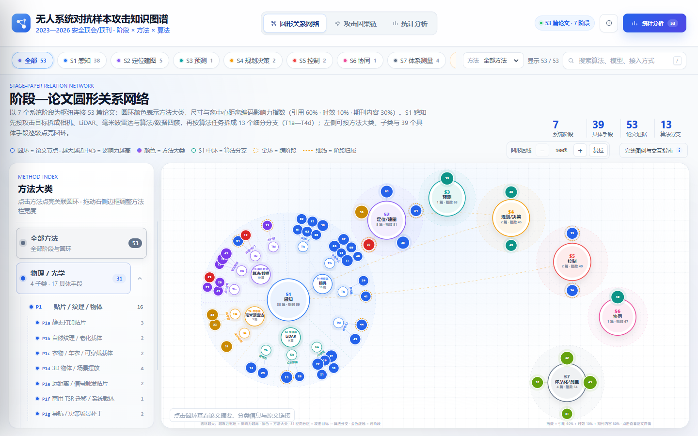
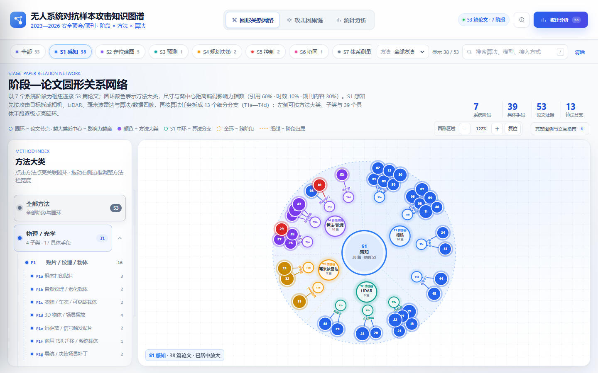

# 无人系统对抗样本攻击知识图谱

2023—2026 年计算机安全顶会 / 顶刊中的无人系统对抗样本攻击研究，按 **7 个攻击阶段 × 6 类攻击方法 × 受影响模型** 组织为可追溯的知识图谱；其中 S1 感知进一步按 **4 个攻击目标 × 13 个算法分支** 展开。

**在线访问：** <https://20bangpower.github.io/uav-adversarial-kg/>



## 内容概览

- 53 篇核心论文，时间范围 2023—2026
- 7 个阶段：感知、定位 / 建图、预测、规划 / 决策、控制、协同、体系化 / 测量
- S1 感知：38 篇论文，分为 4 个攻击目标、13 个算法分支
- 6 个方法大类、14 个方法子类、39 个具体攻击手段
- 8 个受影响模型族，9 篇跨阶段论文
- 52 篇摘要；全部论文提供 DOI 或官方页面链接

## 主要功能

- 圆形阶段—论文网络：按阶段、攻击目标、算法分支筛选，点击论文查看证据
- S1 二级分类：T1a—T4d 分支枢纽、弧形标签与独立证据聚合
- 跨阶段高亮：点击跨阶段后点亮 9 篇论文、相关阶段/分支与跨阶段连线，其余节点自动降亮
- 攻击因果链视图：从攻击手段到系统影响
- 统计分析：阶段与方法体量、论文影响力 Top 12、模型族分化、论文证据清单
- 论文详情：摘要、攻击链路、目标模型、接入方式与原文入口
- 关键词搜索、方法筛选与跨阶段筛选
- 纯静态单页，无需登录、后端或构建步骤

## 本地运行

克隆仓库后直接用浏览器打开 `index.html`：

```bash
git clone https://github.com/20bangpower/uav-adversarial-kg.git
cd uav-adversarial-kg
```

页面所有数据均内嵌于 `index.html`，不依赖网络接口。

## 数据与核验材料

- `docs/data/论文清单_2023-2026.csv`：论文清单与分类字段
- `docs/data/论文清单_2023-2026.xlsx`：Excel 版本
- `docs/data/阶段方法汇总.csv`：阶段 × 方法汇总
- `docs/data/S1攻击目标与算法分支.csv`：S1 的 4 个攻击目标、13 个算法分支及论文映射
- `docs/materials/安全顶会顶刊汇总_2023-2026.md`：会议 / 期刊范围
- `docs/reports/更新核验_2026-10-29.json`：S1 分支、跨阶段高亮与响应式布局核验
- `docs/reports/一致性核验_2026-10-26.json`：字段一致性核验
- `docs/reports/验收报告.json`：数据验收结果

## 数据口径

- 阶段按论文主阶段单次计数，七个阶段合计 53 篇。
- S1 先按攻击目标拆为 T1—T4，再按论文任务与模型字段拆为 13 个算法分支；38 篇论文全部映射，无遗漏、无重复。
- 方法分类包含 6 个大类、14 个子类、39 个具体手段；跨阶段、接入方式与模型字段允许重叠。
- 影响力指数 = `100 × (0.60 × 引用归一化 + 0.10 × 时效归一化 + 0.30 × 期刊内容归一化)`。
- 引用数据来自 OpenAlex / Crossref；46 篇为精确引用数，7 篇缺失值按同期刊同年份中位数估算，并在论文详情中标注。

## S1 感知分类与跨阶段高亮




## 更新记录

### 2026-10-29

- S1 感知新增 4 个攻击目标与 13 个算法分支，并在圆形网络中增加分支枢纽、标签与分区线。
- S1 详情增加“按算法分支”分布和“攻击目标 → 算法分支”证据结构；论文详情增加算法分支字段。
- 跨阶段筛选增加节点高亮、非匹配节点降亮、相关阶段/目标/分支与跨阶段连线联动。
- CSV / XLSX 增加攻击目标与算法分支字段，并新增 S1 分类汇总表。
- README 与预览图同步更新。

## 说明

本项目用于学术研究交流与成果展示。论文原文版权归原作者与出版方所有，引用信息以 DOI / 官方页面为准。
